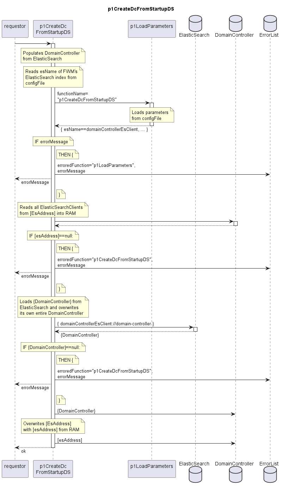

# p1CreateDcFromStartupDS

Builds up the data structure of the DomainController from ElasticSearch.  
Loads the configuration information that is directly attached to the DomainController and the persistent copy of the RunningDS (StartupDS).  

## Diagram

  

## Interface

Please find a detailed description of the [interface](./interface.yaml).  

## Variables

Please find a detailed description of the [variables](./variables.yaml).  

## Parameters

| Parameter Name | Description                                                                                                |
|----------------|------------------------------------------------------------------------------------------------------------|
| esName         | Name of the ElasticSearch client that connects the persistent copy of the DomainController incl. StartupDS |

In the initial release, the ElasticSearchClient's name is domainControllerEsClient.  

## NPM Module

[mw-sdn-p1-create-dc-from-startup-ds](https://www.npmjs.com/package/mw-sdn-p1-create-dc-from-startup-ds)  
