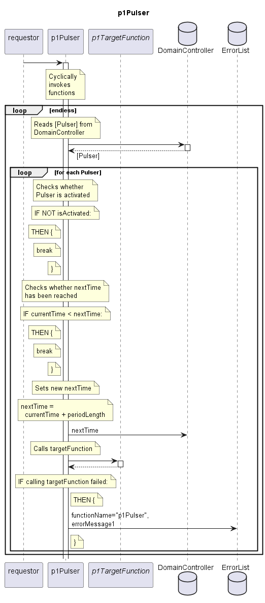

# p1Pulser

Cyclically invokes functions of all categories.  
Both request and response must be without any body.  
Configured through DomainController::Pulser.  

The periodLength parameter defines the time period in seconds.  

## Diagram

  

## Interface

Please find a detailed description of the [interface](./interface.yaml).  

## Variables

Please find a detailed description of the [variables](./variables.yaml).  

## Parameters

./.  

## NPM Module

[mw-sdn-p1-pulser](https://www.npmjs.com/package/mw-sdn-p1-pulser)  
