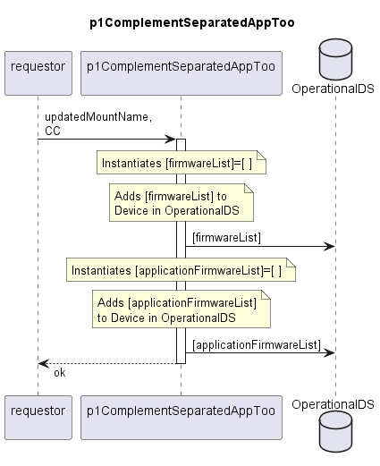

# p1ComplementSeparatedAppToo

Complements the Device object in OperationalDS with hardware and firmware attributes required for a Device of firmwareStructure==separated-application.  

In its current version, the following attributes get added:

- empty [firmware-list] attribute
- empty [application-firmware-list] attribute

## Diagram

  

## Interface

Please find a detailed description of the [interface](./interface.yaml).  

## Variables

Please find a detailed description of the [variables](./variables.yaml).  

## Parameters

./.  

## NPM Module

[mw-sdn-p1-complement-separated-app-too](https://www.npmjs.com/package/mw-sdn-p1-complement-separated-app-too)
