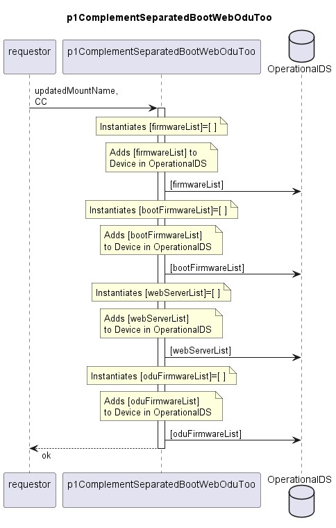

# p1ComplementSeparatedBootWebOduToo

Complements the Device object in OperationalDS with hardware and firmware attributes required for a Device of firmwareStructure==separated-boot-and-web-and-odu.  

In its current version, the following attributes get added:

- empty [firmware-list] attribute
- empty [boot-firmware-list] attribute
- empty [web-server-list] attribute
- empty [odu-firmware-list] attribute

## Diagram

  

## Interface

Please find a detailed description of the [interface](./interface.yaml).  

## Variables

Please find a detailed description of the [variables](./variables.yaml).  

## Parameters

./.  

## NPM Module

[mw-sdn-p1-complement-separated-boot-web-odu-too](https://www.npmjs.com/package/mw-sdn-p1-complement-separated-boot-web-odu-too)
