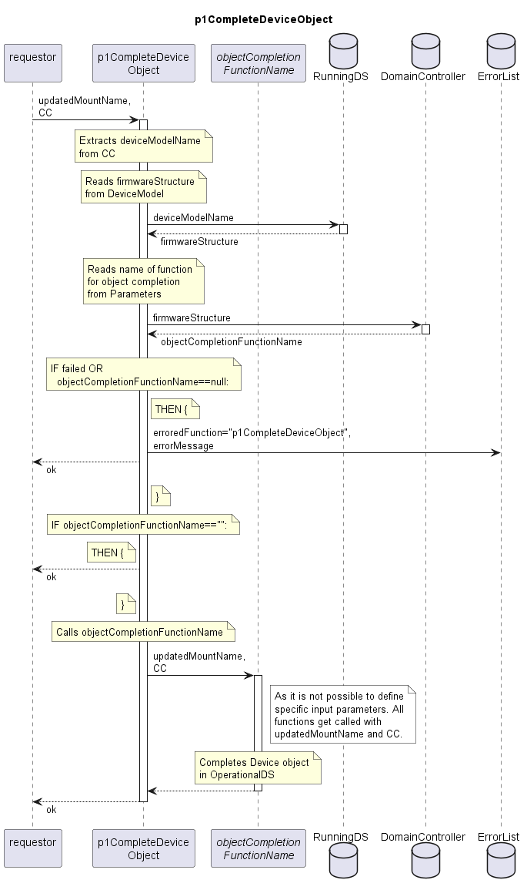

# p1CompleteDeviceObject

Calls the right sub-function for adding the firmwareStructure-specific firmwareList attributes to the Device object in the OperationalDS.  

## Diagram

  

## Interface

Please find a detailed description of the [interface](./interface.yaml).  

## Variables

Please find a detailed description of the [variables](./variables.yaml).  

## Parameters

| Parameter Name      | Description                                                                                                                                                                                           |
|---------------------|-------------------------------------------------------------------------------------------------------------------------------------------------------------------------------------------------------|
| [firmwareStructure] | Special usage of the Parameters. For all Parameters with attribute description==objectCompletionFunction, attribute value contains the name of the subfunction to be called by p1CompleteDeviceObject |

## NPM Module

[mw-sdn-p1-complete-device-object](https://www.npmjs.com/package/mw-sdn-p1-complete-device-object)
