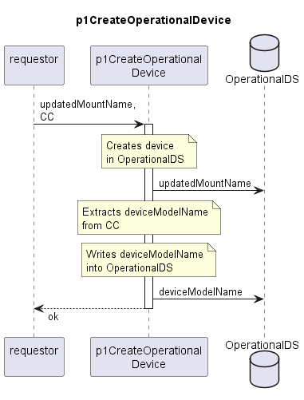

# p1CreateOperationalDevice

Creates a device in the OperationalDS.

## Diagram

  

## Interface

Please find a detailed description of the [interface](./interface.yaml).  

## Variables

Please find a detailed description of the [variables](./variables.yaml).  

## Parameters

./.

## NPM Module

[mw-sdn-p1-create-device](https://www.npmjs.com/package/mw-sdn-p1-create-device)
