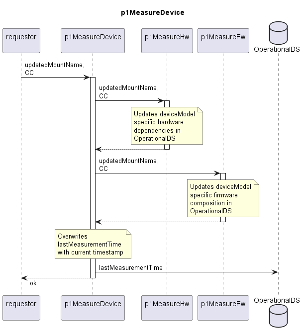

# p1MeasureDevice

Updates a Device in the OperationalDS.  

## Diagram

  

## Interface

Please find a detailed description of the [interface](./interface.yaml).  

## Variables

Please find a detailed description of the [variables](./variables.yaml).  

## Parameters

./.  

## NPM Module

[mw-sdn-p1-measure-device](https://www.npmjs.com/package/mw-sdn-p1-measure-device)
