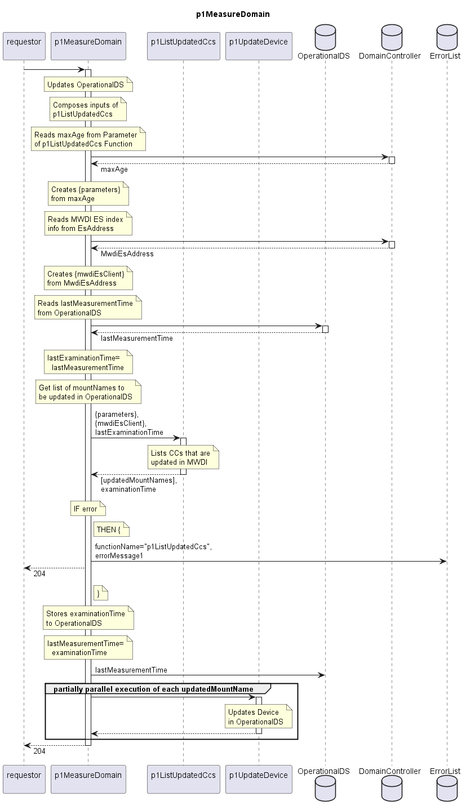

# p1MeasureDomain

Orchestrates updating the OperationalDS.  

## Diagram

  

## Interface

Please find a detailed description of the [interface](./interface.yaml).  

## Variables

Please find a detailed description of the [variables](./variables.yaml).  

## Parameters

| Parameter                  | Description                                                                   |
|----------------------------|-------------------------------------------------------------------------------|
| listUpdatedCcsFunctionName | Name of the function that provides the list of updated ControlConstructs      |
| measureDeviceFunctionName  | Name of the function that updates the device information in the OperationalDS |
| mwdiEsName                 | Name of the Elasticsearch index to be used for loading the MWDI data          |

## NPM Module

[mw-sdn-p1-measure-domain](https://www.npmjs.com/package/mw-sdn-p1-measure-domain)
