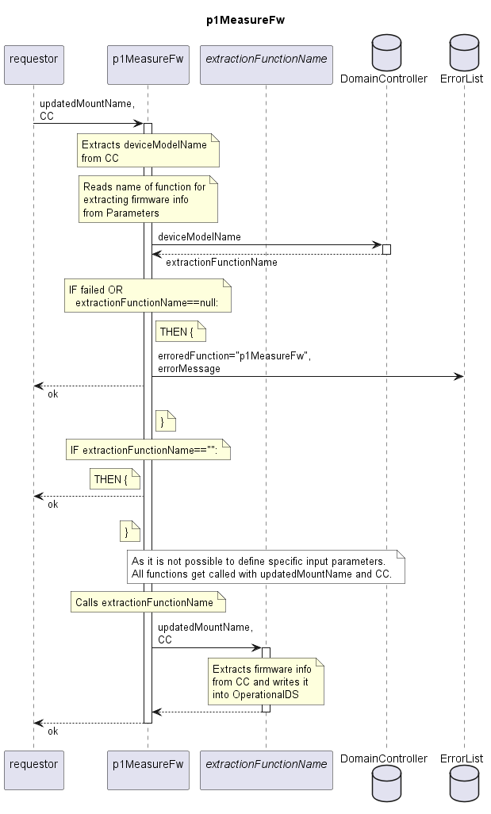

# p1MeasureFw

Updates the information about the composition of firmware on a Device in the OperationalDS.  
Depending on the deviceModel, different subfunctions get called to allow different information structures.  

## Diagram

  

## Interface

Please find a detailed description of the [interface](./interface.yaml).  

## Variables

Please find a detailed description of the [variables](./variables.yaml).  

## Parameters

| Parameter Name    | Description                                                                                                                                                                                  |
|-------------------|----------------------------------------------------------------------------------------------------------------------------------------------------------------------------------------------|
| [deviceModelName] | Special usage of the Parameters. For all Parameters with attribute description==firmwareExtractionFunction, attribute value contains the name of the subfunction to be called by p1MeasureFw |

In its initial release, the ElasticSearchClients domainControllerEsClient and mwdiEsClient are defined.  

## NPM Module

[mw-sdn-p1-measure-fw](https://www.npmjs.com/package/mw-sdn-p1-measure-fw)
