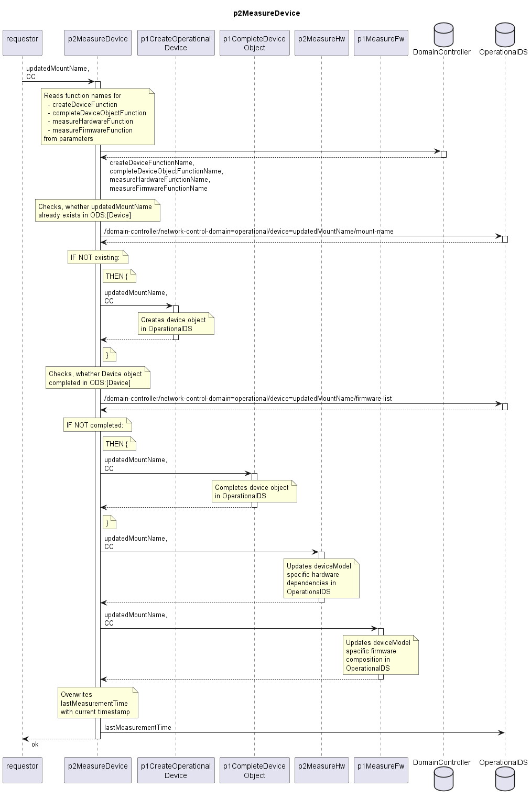

# p2MeasureDevice

Updates a Device in the OperationalDS.  

Changes from p1 to p2:  

- reads functionNames from Parameters instead of hard coding
- calls subfunction for creating Device object in OperationalDS
- calls subfunction for equipping Device object in OperationalDS with firmwareStructure specific attributes

## Diagram

  

## Interface

Please find a detailed description of the [interface](./interface.yaml).  

## Variables

Please find a detailed description of the [variables](./variables.yaml).  

## Parameters

| Parameter                        | Description                                                             |
|----------------------------------|-------------------------------------------------------------------------|
| createDeviceFunctionName         | Name of the function for creating devices in the OperationalDS          |
| completeDeviceObjectFunctionName | Name of the function for completing device objects in the OperationalDS |
| measureHardwareFunctionName      | Name of the function for measuring hardware                             |
| measureFirmwareFunctionName      | Name of the function for measuring firmware                             |

## NPM Module

[mw-sdn-p2-measure-device](https://www.npmjs.com/package/mw-sdn-p2-measure-device)
