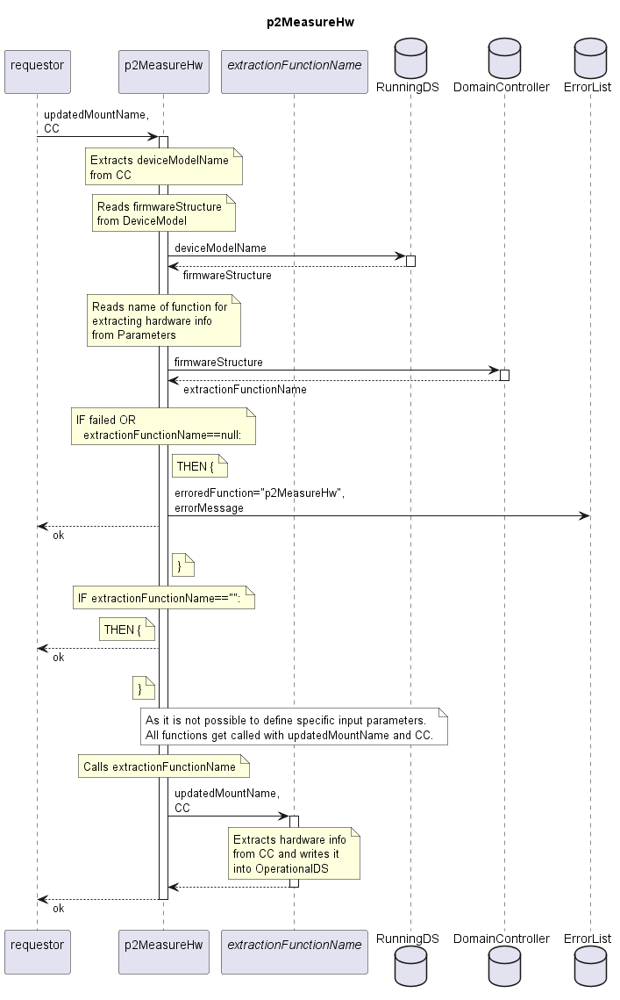

# p2MeasureHw

Updates the hardware information required to resolve dependencies of firmware for a Device in the OperationalDS.  
Depending on the deviceModel, respectively its firmwareStructure, different subfunctions get called to allow different information structures.  

Changes from p1 to p2:  

- does no longer write the deviceModelName into the Device in the OperationalDS

## Diagram

  

## Interface

Please find a detailed description of the [interface](./interface.yaml).  

## Variables

Please find a detailed description of the [variables](./variables.yaml).  

## Parameters

| Parameter Name      | Description                                                                                                                                                                                  |
|---------------------|----------------------------------------------------------------------------------------------------------------------------------------------------------------------------------------------|
| [firmwareStructure] | Special usage of the Parameters. For all Parameters with attribute description==hardwareExtractionFunction, attribute value contains the name of the subfunction to be called by p2MeasureHw |

## NPM Module

[mw-sdn-p2-measure-hw](https://www.npmjs.com/package/mw-sdn-p2-measure-hw)
