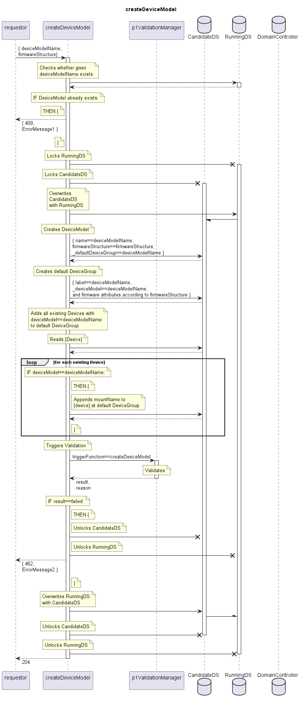

# createDeviceModel

Creates a new DeviceModel and a corresponding default DeviceGroup.  
Adds all existing Devices with deviceModel==deviceModelName to the default DeviceGroup.  

Important: The value of firmwareStructure is invariant. It is important that the correct FirmwareStructure is selected at the moment the DeviceModel is created as the DeviceModel cannot be deleted as long as Devices referencing it exist.  

The value of defaultDeviceGroup is invariant, means DeviceModel and default DeviceGroup are permanently associated.  

Changes from 1.0 to 2.0:  

- hardwareExtractionFunction and firmwareStructure have been removed from input parameters
- documenting them as parameters of the MeasurementFunctions has been removed
- firmwareStructure has been added as an input parameter
- deviceGroup now created with deviceModel specific set of firmware lists

## Diagram

  

## Interface

Please find a detailed description of the interface in the [openAPI specification](../../../FirmWareManager.yaml).  

## Variables

Please find a detailed description of the [variables](./variables.yaml).  

## Error Codes

|#| Code | Message                             |
|-|------|-------------------------------------|
|1| 409  | Conflict                            |
|2| 462  | _[provided by ValidationFunctions]_ |

## Parameters

| Parameter Name   | Description |
|------------------|-------------|
| updateHwFunction | p1MeasureHw |
| updateFwFunction | p1MeasureFw |

## NPM Module

[onf-core-model-ap](https://www.npmjs.com/package/onf-core-model-ap) to be complemented.  
