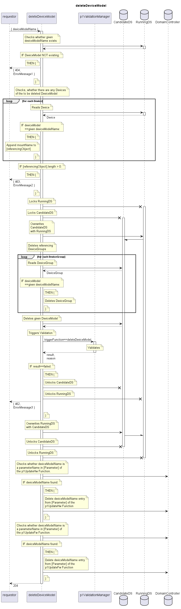

# deleteDeviceModel

Deletes a DeviceModel and all referencing DeviceGroups.  
The deletion will be aborted, if there are any Devices that are of the to be deleted DeviceModel.  
A list of Devices will be returned in that case.  

hardwareExtractionFunction and firmwareExtractionFunction entries are deleted from the Parameters of the respective MeasurementFunctions in the DomainController.  

## Diagram

  

## Interface

Please find a detailed description of the interface in the [openAPI specification](../../../FirmWareManager.yaml).  

## Variables

Please find a detailed description of the [variables](./variables.yaml).  

## Error Codes

|#| Code | Message                                |
|-|------|----------------------------------------|
|1| 404  | Not Found                              |
|2| 463  | To be deleted object still referenced. |
|3| 462  | _[provided by ValidationFunctions]_    |

## Parameters

| Parameter Name   | Description |
|------------------|-------------|
| updateHwFunction | p1MeasureHw  |
| updateFwFunction | p1MeasureFw  |

## NPM Module

[onf-core-model-ap](https://www.npmjs.com/package/onf-core-model-ap) to be complemented.  
