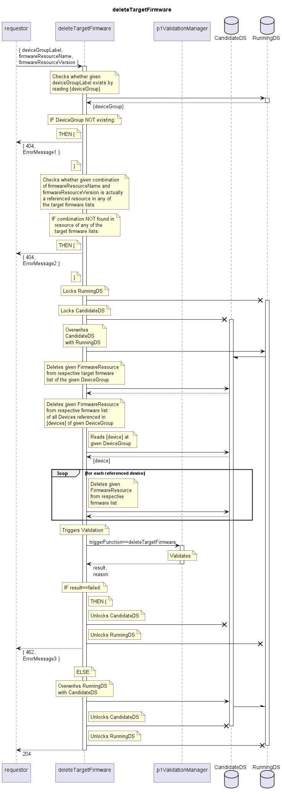

# deleteTargetFirmware

Deletes a FirmwareResource from one of the target firmware lists of the given DeviceGroup.  
Deletes the same firmware from the respective firmware list of all Devices referenced by the given DeviceGroup.  

Consequences: The firmware will no longer be attempted to be loaded onto the devices.  

Changes from 1.0 to 2.0:  

- The service now considers all firmwareStructure specific target firmware lists.

## Diagram

  

## Interface

Please find a detailed description of the interface in the [openAPI specification](../../../FirmWareManager.yaml).  

## Variables

Please find a detailed description of the [variables](./variables.yaml).  

## Error Codes

|#| Code | Message                             |
|-|------|-------------------------------------|
|1| 404  | Not Found                           |
|2| 404  | Not Found                           |
|3| 462  | _[provided by ValidationFunctions]_ |

## Parameters

./.  

## NPM Module

[onf-core-model-ap](https://www.npmjs.com/package/onf-core-model-ap) to be complemented.  
