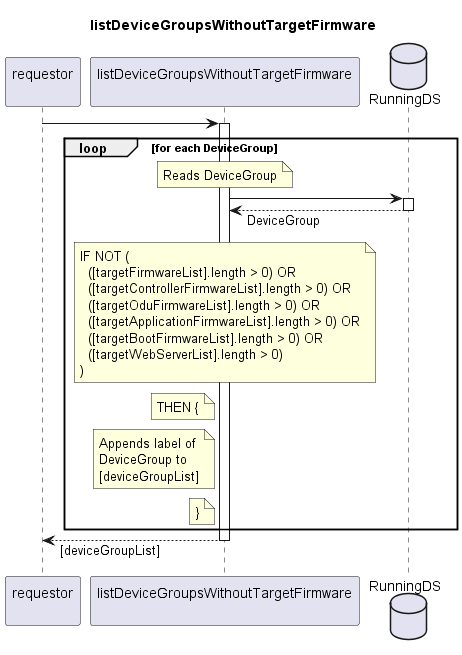

# listDeviceGroupsWithoutTargetFirmware

Lists DeviceGroups that do not reference any target firmware in any of the firmwareStructure specific target firmware lists.  

Changes from 1.0 to 2.0:  

- The service now considers all firmwareStructure specific target firmware lists.

## Diagram

  

## Interface

Please find a detailed description of the interface in the [openAPI specification](../../../FirmWareManager.yaml).  

## Variables

./.  

## Error Codes

./.  

## Parameters

./.  

## NPM Module

[onf-core-model-ap](https://www.npmjs.com/package/onf-core-model-ap) to be complemented.  
