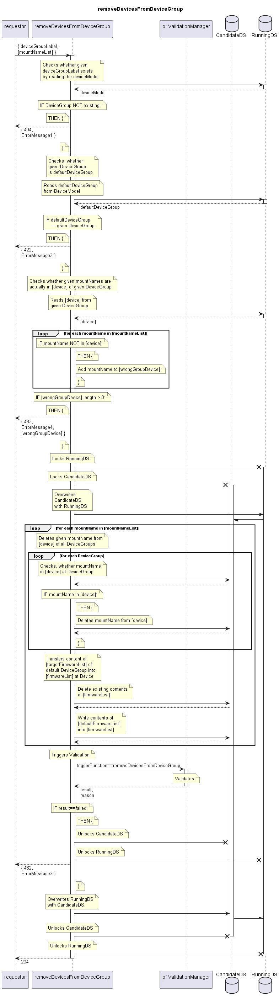

# removeDevicesFromDeviceGroup

References to the given Devices get transferred from the given DeviceGroup to the default DeviceGroup of their DeviceModel.  
(Does not indicate errors, if a given Device does not exist or is not referenced by the given DeviceGroup.)  
Updates the firmwareList of the given Devices according to the targetFirmwareList of the default DeviceGroup.  

Consequences: The target firmware of the default DeviceGroup will be attempted to be loaded onto the devices and activated.  

## Diagram

  

## Interface

Please find a detailed description of the interface in the [openAPI specification](../../../FirmWareManager.yaml).  

## Variables

Please find a detailed description of the [variables](./variables.yaml).  

## Error Codes

|#| Code | Message                             |
|-|------|-------------------------------------|
|1| 404  | Not Found                           |
|3| 422  | Unprocessable Content               |
|4| 462  | _[provided by ValidationFunctions]_ |

## Parameters

./.  

## NPM Module

[onf-core-model-ap](https://www.npmjs.com/package/onf-core-model-ap) to be complemented.  
