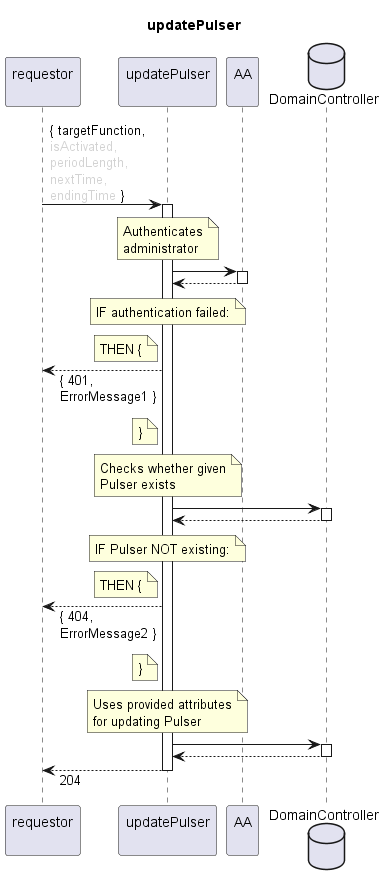

# updatePulser

Updates an existing Pulser definition.  

## Diagram

  

## Interface

Please find a detailed description of the interface in the [openAPI specification](../../../FirmWareManager.yaml).  

## Variables

./.  

## Error Codes

|#| Code | Message                             |
|-|------|-------------------------------------|
|1| 401  | Unauthorized                        |
|2| 404  | Not Found                           |

## Parameters

./.  

## NPM Module

[onf-core-model-ap](https://www.npmjs.com/package/onf-core-model-ap) to be complemented.  
