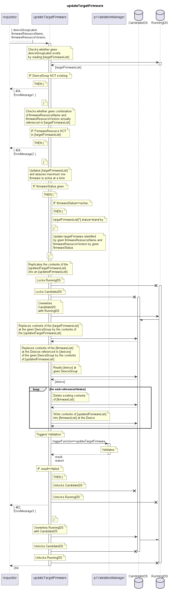

# updateTargetFirmware

Updates an entry in the targetFirmwareList of a given DeviceGroup in the provided attributes (currently limited to the administrative state of the firmware).  
Replicates the same changes into the firmwareList of all Devices referenced by the given DeviceGroup.  

Consequences: Depending on the kind of update, some downloaded firmware might be activated, which involves restarting the affected devices.  

Remark: This service is for updating an existing target firmware entry. As long as the main firmware package is the only type of firmware allowing updating any attribute (status), additional target firmware lists do not create any need for change on this service.

## Diagram

  

## Interface

Please find a detailed description of the interface in the [openAPI specification](../../../FirmWareManager.yaml).  

## Variables

Please find a detailed description of the [variables](./variables.yaml).  

## Error Codes

|#| Code | Message                             |
|-|------|-------------------------------------|
|1| 404  | Not Found                           |
|2| 404  | Not Found                           |
|3| 462  | _[provided by ValidationFunctions]_ |

## Parameters

./.  

## NPM Module

[onf-core-model-ap](https://www.npmjs.com/package/onf-core-model-ap) to be complemented.  
