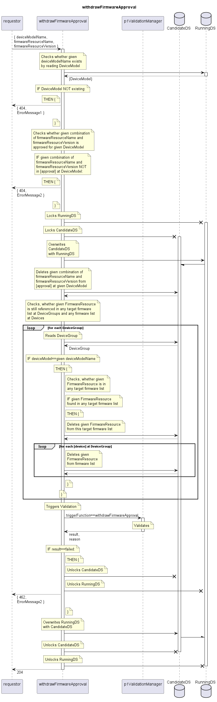

# withdrawFirmwareApproval

Deletes a firmware approval from a given DeviceModel.  
Removes the withdrawn firmware from all target firmware lists of all DeviceGroups referencing the given DeviceModel.  
Removes the withdrawn firmware from all firmware lists of all Devices referenced by the same DeviceGroups.  

Changes from 1.0 to 2.0:  

- withdrawn firmware now being removed from all device model specific target firmware lists in DeviceGroups
- withdrawn firmware now being removed from all device model specific firmware lists in Devices

## Diagram

  

## Interface

Please find a detailed description of the interface in the [openAPI specification](../../../FirmWareManager.yaml).  

## Variables

Please find a detailed description of the [variables](./variables.yaml).  

## Error Codes

|#| Code | Message                             |
|-|------|-------------------------------------|
|1| 404  | Not Found                           |
|2| 404  | Not Found                           |
|3| 462  | _[provided by ValidationFunctions]_ |

## Parameters

./.  

## NPM Module

[onf-core-model-ap](https://www.npmjs.com/package/onf-core-model-ap) to be complemented.  
