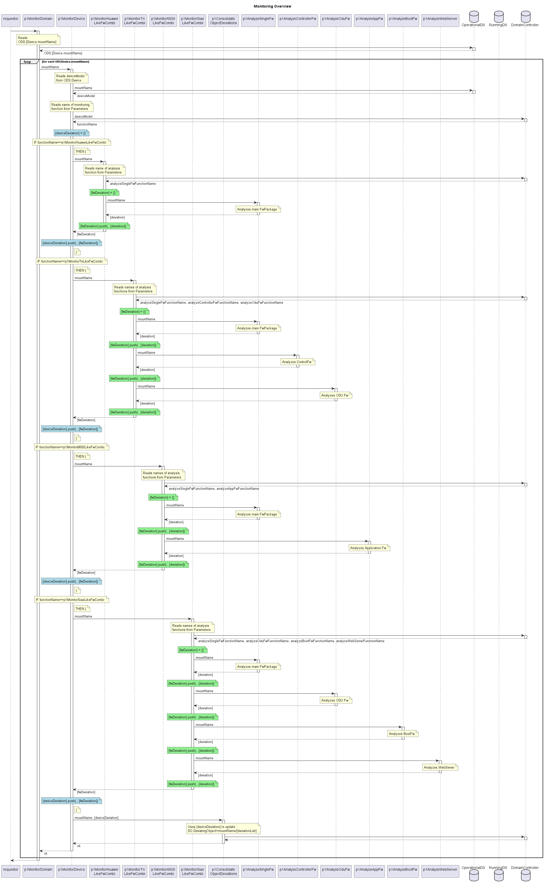
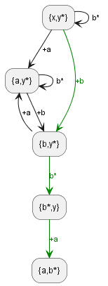
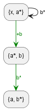
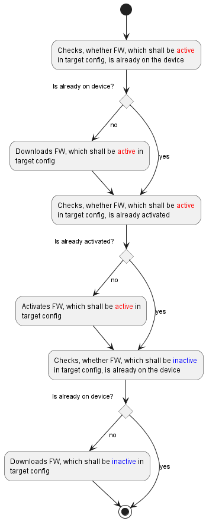
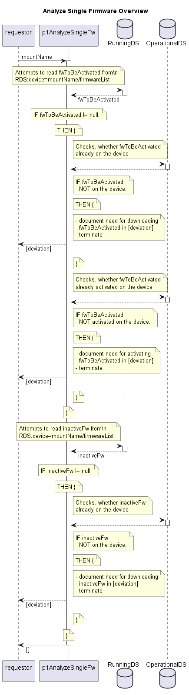
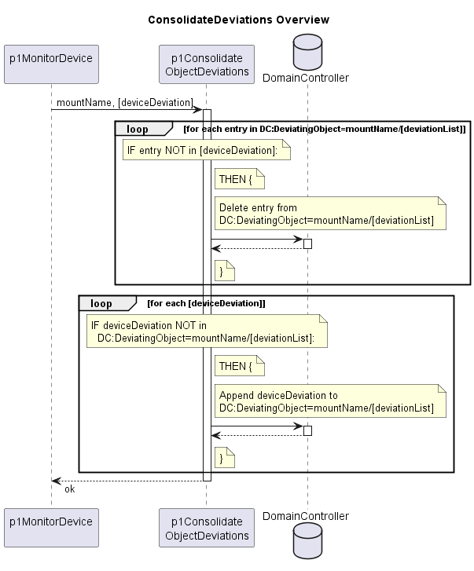

# Concepts of Monitoring

## Basics

Monitoring vergleicht den Ist-Zustand im OperationalDS (ODS) mit dem Soll-Zustand im RunningDS (RDS) und trägt Änderungsbedarf in die ToDoListe ein.  

| DataStore Inhalte                          | Folge                                                                    |
|--------------------------------------------|--------------------------------------------------------------------------|
| Gerät existiert im ODS nicht               | Fall wird nicht sichtbar, weil Liste der Geräte im ODS abgearbeitet wird |
| Gerät existiert im RDS nicht               | keine Folge                                                              |
| Gerät im RDS definiert keinen Soll-Zustand | keine Folge                                                              |
| Soll-Zustand == Ist-Zustand                | keine Folge                                                              |
| Soll-Zustand != Ist-Zustand                | Eintrag in ToDoListe                                                     |

## Abgrenzung zur Implementierung

- Monitoring:
  - Stellt Abweichung des Soll-Zustands vom Ist-Zustand fest
  - Legt den oder die nächsten Schritte fest
  - Beachtet dabei den Netzwerkkontext (was)
  - Definiert die Reihenfolge (bestimmt damit auch, ob deterministisch oder chaotisch vorgegangen werden soll)*
  - Versucht hardwarespezifisches möglichst zu abstrahieren

- Implementation:
  - Setzt die festgelegten nächsten Schritte um
  - Beachtet dabei das Hardwarespezifische (wie)
  - Beachtet dabei die operativen Anforderungen (z.B. wann)

*) Das Vorgeben einer konkreten Reihenfolge geschieht durch Eintragen jeweils genau eines nächsten Schrittes.  

## Overview

  

## More detailed Concept of Analyzing Main Firmware Package

### Approach

Zunächst ist zu klären, ob ein deterministisches oder ein chaotisches Vorgehen zu bevorzugen ist.  
Gegen das chaotische Vorgehen spricht, dass der Download von Firmware eine Belastung für das DC-Netzwerk darstellt.  
Darum ist zu prüfen, ob es ein einfach zu beschreibendes deterministisches Vorgehen gibt.  

Zwei Fälle sollen exemplarisch betrachtet werden:  

- Neues Gerät mit völlig unbekannter Konfiguration
- Nicht aktive Firmware soll durch eine zu aktivierende ersetzt werden

### Assumptions

Annahmen zu den Eigenschaften der Geräte:

- Das Gerät hat zwei Firmware-Bänke
- Eine Bank ist aktiv, die andere inaktiv
- Die aktive Bank enthält die aktuell laufende Firmware
- Es gibt die beiden getrennten Aktivitäten Download und Aktivierung
- Beim Download wird die neue Firmware in die inaktive Bank geschrieben
- Bei der Aktivierung wird die inaktive Bank zur aktiven Bank und umgekehrt
- Die Firmware-Versionen können in beliebiger Reihenfolge geladen und aktiviert werden

### State Diagrams

**Legende zu den Zustandsdiagrammen:**  

- Die Zustände (z.B. {x, y\*}) beschreiben den Inhalt der beiden Firmware-Bänke
  - {x, y\*} == {y\*, x}
  - x und y stehen für unbekannte Firmware-Versionen
  - \* kennzeichnet die aktive Firmware
  - a und b stehen für die exakt bestimmten Firmware-Versionen der Zielkonfiguration
- Die Übergänge beschreiben mögliche Aktivitäten
  - +a bzw. +b kennzeichnen den Download der Firmware-Version a bzw. b
  - a\* bzw. b\* kennzeichnen die Aktivierung der Firmware-Version a bzw. b

Da eine mögliche Aktivität das Bestehen einer Abweichung von der Zielkonfiguration bedarf, nimmt die Anzahl der von einem Zustand ausgehenden Übergänge mit zunehmender Annäherung an die Zielkonfiguration ab.  

**Neues Gerät mit völlig unbekannter Konfiguration:**  

Die Zielkonfiguration {a, b\*} muss ausgehend von der Konfiguration {x, y\*} erreicht werden.  

  

**Nicht aktive Firmware soll durch eine zu aktivierende ersetzt werden:**  

Die Zielkonfiguration {a, b\*} muss ausgehend von der Konfiguration {x, a\*} erreicht werden.  

  

### Generic Process

Aus den beiden betrachteten Fällen ließe sich folgender generischer Prozess ableiten:

  

### Overview p1AnalyzeSingleFw

  

## Overview Deviation Handling

The deviation handling needs to be expanded for sending update information to the ticketing system in a future release.  

  

